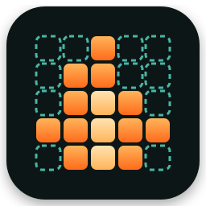
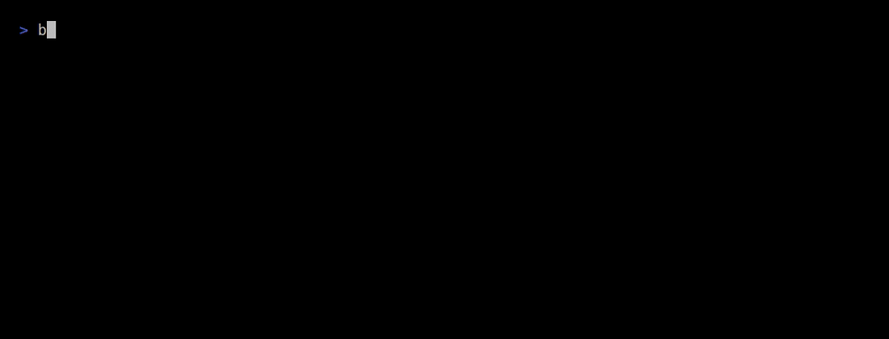

<p align="center">
  
</p>

<h1 align="center">mojo-dllm</h1>

<p align="center"><em>Local inference for diffusion language models, written in Mojo.</em></p>

<p align="center">
  <a href="https://github.com/vladimirrott/mojo-dllm/actions/workflows/ci.yml"></a>
  <a href="LICENSE"></a>
  
  
</p>

<p align="center">
  <a href="#benchmarks">Benchmarks</a> ·
  <a href="#quick-start">Quick start</a> ·
  <a href="#how-it-works">How it works</a> ·
  <a href="#correctness">Correctness</a> ·
  <a href="#status">Status</a> ·
  <a href="docs/introduction.md">Docs</a>
</p>

<p align="center">
  
</p>

mojo-dllm runs **LLaDA-8B-Instruct**, **LLaDA-1.5**, **Dream-v0-Instruct-7B**,
**Dream-Coder-v0-Instruct-7B** and **DiffuCoder-7B-cpGRPO** from quantized GGUF
files. LLaDA-8B and Dream-v0 have CPU and NVIDIA GPU evidence; the added
checkpoints have CPU smoke and [parity results](docs/correctness.md).

The GGUF reader, the tokenizer, the quantized matrix multiply, the GPU kernels, the transformer
and the denoising loop are all Mojo. You need no Python at runtime, and the
GPU is optional.

A diffusion model does not write left to right. It starts from a canvas of
masked tokens and, over a fixed number of steps, commits the tokens it is most
sure about until none are left. Every step reruns the whole model over the
whole canvas, so the runtime problem looks like a stream of GEMMs. mojo-dllm
is built around that.

## Benchmarks

<!-- bench:start -->
**LLaDA-8B-Instruct**, Q4_K_M. 13th Gen Intel(R) Core(TM) i5-13420H, 12 threads, 33.3 GB RAM, `performance` power profile. Each prompt: 128 generated tokens, 32 denoising steps; median of 3 runs x 3 prompts.

| Runtime | ms / step | tokens / s | startup | peak RSS | language |
|---|---:|---:|---:|---:|---|
| **mojo-dllm** | 3,005 | 1.33 | 1.8 s | 5.9 GB | Mojo |
| mojo-dllm, logits for every position (ablation) | 3,268 | 1.22 | 1.8 s | 5.9 GB | Mojo |
| llama.cpp `llama-diffusion-cli` | 5,807 | 0.69 | 2.5 s | 8.4 GB | C/C++ |
| diffuse-cpp, cache off | 9,996 | 0.40 | 2.3 s | 8.2 GB | C++ |
| diffuse-cpp, cache + `entropy_exit` † | 4,380 | 1.12 | 2.6 s | 8.4 GB | C++ |

Versions: mojo-dllm `bdd268b`, Mojo 1.1.0 (8189361e), llama.cpp `836d571`, diffuse-cpp `1d2bd6a`. Evidence: `bench/results/2026-10-03-cpu-diffuse.json`, `bench/results/2026-10-03-cpu-llada.json`.

† Not the same work: the inter-step cache reuses stale K/V and `entropy_exit` can stop early. Shown because it is diffuse-cpp's recommended mode.

**LLaDA-8B-Instruct** on the GPU, Q4_K_M. NVIDIA GeForce RTX 3050 6GB Laptop GPU (6144 MiB, driver 595.84), host 13th Gen Intel(R) Core(TM) i5-13420H. Each prompt: 128 generated tokens, 32 denoising steps; median of 3 runs x 3 prompts. Peak RSS is host memory.

| Runtime | ms / step | tokens / s | startup | peak RSS | language |
|---|---:|---:|---:|---:|---|
| **mojo-dllm** `--device gpu` | 424 | 9.43 | 2.9 s | 1.0 GB | Mojo |
| llama.cpp `llama-diffusion-cli`, CUDA, all layers offloaded | 255 | 15.68 | 2.0 s | 5.2 GB | C/C++, CUDA |

Versions: mojo-dllm `78014b4`, Mojo 1.1.0 (8189361e), llama.cpp `836d571`. Evidence: `bench/results/2026-10-12-gpu-llada.json`.

**Dream-v0-Instruct-7B**, Q4_K_M. 13th Gen Intel(R) Core(TM) i5-13420H, 12 threads, 33.3 GB RAM, `performance` power profile. Each prompt: 128 generated tokens, 32 denoising steps; median of 3 runs x 3 prompts.

| Runtime | ms / step | tokens / s | startup | peak RSS | language |
|---|---:|---:|---:|---:|---|
| **mojo-dllm** | 2,967 | 1.35 | 1.7 s | 5.6 GB | Mojo |
| llama.cpp `llama-diffusion-cli` | 5,566 | 0.72 | 2.5 s | 8.0 GB | C/C++ |

Versions: mojo-dllm `bdd268b`, Mojo 1.1.0 (8189361e), llama.cpp `836d571`. Evidence: `bench/results/2026-10-03-cpu-dream.json`.

**Dream-v0-Instruct-7B** on the GPU, Q4_K_M. NVIDIA GeForce RTX 3050 6GB Laptop GPU (6144 MiB, driver 595.84), host 13th Gen Intel(R) Core(TM) i5-13420H. Each prompt: 128 generated tokens, 32 denoising steps; median of 3 runs x 3 prompts. Peak RSS is host memory.

| Runtime | ms / step | tokens / s | startup | peak RSS | language |
|---|---:|---:|---:|---:|---|
| **mojo-dllm** `--device gpu` | 412 | 9.71 | 2.9 s | 1.1 GB | Mojo |
| llama.cpp `llama-diffusion-cli`, CUDA, all layers offloaded | 234 | 17.08 | 1.9 s | 4.9 GB | C/C++, CUDA |

Versions: mojo-dllm `036ef79`, Mojo 1.1.0 (8189361e), llama.cpp `836d571`. Evidence: `bench/results/2026-10-12-gpu-dream.json`.

**LLaDA-8B-Instruct, llama.cpp thread sweep and forward pass alone**: 13th Gen Intel(R) Core(TM) i5-13420H; median of 2 runs, one prompt, canvas 148 tokens.

| Runtime | threads | ms / step | forward pass alone |
|---|---:|---:|---:|
| mojo-dllm | 12 | 3,014 | 3,011 ms |
| llama.cpp | 4 | 7,284 | 7,098 ms |
| llama.cpp | 6 | 6,416 | 7,046 ms |
| llama.cpp | 8 | 6,140 | 6,242 ms |
| llama.cpp | 12 | 5,703 | 5,748 ms |

The ms / step column runs `llama-diffusion-cli`. The forward pass alone is mojo-dllm's measured forward pass against llama.cpp's `llama-bench` at the same token count. `llama-bench` applies a causal mask and computes logits for one position; mojo-dllm's figure includes logits for up to 32 positions and copying the canvas in. CPU busy before a run: at most 6.5%. Evidence: `bench/results/2026-10-09-fair-cpu-llada.json`.

**LLaDA-8B-Instruct on the GPU, forward pass alone**: NVIDIA GeForce RTX 3050 6GB Laptop GPU; median of 3 runs, one prompt, canvas 148 tokens.

| Runtime | ms / step | forward pass alone |
|---|---:|---:|
| mojo-dllm `--device gpu` | 419 | 415 ms |
| llama.cpp CUDA, `llama-bench -p 148` | | 264 ms |

The forward pass alone is mojo-dllm's measured forward pass against llama.cpp's `llama-bench` at the same token count. `llama-bench` applies a causal mask and computes logits for one position; mojo-dllm's figure includes logits for up to 32 positions and copying the canvas in. CPU busy before a run: at most 8.9%. Evidence: `bench/results/2026-10-12-fair-gpu-llada.json`.
<!-- bench:end -->

On the CPU, mojo-dllm is the fastest runtime in these tables. The fairness
runs check that lead: llama.cpp is fastest at 12 threads, the most this CPU
runs, and mojo-dllm's forward pass alone stays ahead of `llama-bench`. The
ablation row shows that skipping logits saves only a small part of the gap. On the GPU, llama.cpp's CUDA build is faster.
mojo-dllm's tensor-core kernels are a first version, and what they give you
today is a small host footprint: the weights live in GPU memory.

Every number above is rendered from a result file in `bench/results/`, and CI
fails if the table and the file disagree. [Benchmarks](docs/benchmarks.md)
explains the setup, including why each runtime's schedule differs and what
the ablation row measures.

## Quick start

```bash
curl -LsSf https://astral.sh/uv/install.sh | sh    # skip if you have uv
git clone https://github.com/vladimirrott/mojo-dllm && cd mojo-dllm
./mojo-dllm setup
./mojo-dllm run "Explain speculative decoding in two sentences."
```

`setup` checks the machine, installs the pinned Mojo toolchain into `.venv`,
builds `build/mojo-dllm`, offers to download LLaDA-8B (4.9 GB, sha256
checked) and runs a short smoke test. A second `setup` skips the build and
the download when they are current. `./mojo-dllm doctor` reports what is
missing and the command that fixes it.

You need Linux on x86-64 with AVX2, glibc 2.34 or newer, and about 6 GB of
free memory. `run` picks an NVIDIA GPU with compute capability 8.0 or newer
when it finds one, and the CPU otherwise; `--device cpu` or `--device gpu`
overrides the choice. The GPU path has been measured on an RTX 3050 Laptop
GPU only. If the card has too little free memory, mojo-dllm says how much it
needs and exits.

`-m` takes another model: a path to a `.gguf` file, or a Hugging Face repo as
`owner/repo[:QUANT]`. The [quick start guide](docs/quickstart.md) covers
models, offline use, `inspect`, `tokenize` and the flags.

## How it works

- **Weights repacked for a skinny GEMM.** At load, every Q4_K and Q6_K matrix
  is interleaved 8 rows per 256-bit register, so one AVX-VNNI `vpdpbusd`
  computes 8 rows × 4 multiply-adds against int8 activations. Q4_K stays
  4-bit. [The quantized GEMM](docs/kernels.md) has the layout.
- **Threads that suit hybrid CPUs.** Work goes out one item at a time from an
  atomic counter, so performance cores take more than efficiency cores.
- **Int8 tensor cores on the GPU.** With `--device gpu`, every projection
  reads the same Q4_K and Q6_K blocks from GPU memory and multiplies them on
  the tensor cores: one `mma` per 32-weight Q4_K sub-block, one per 16-weight
  Q6_K group. Attention runs on the f16 tensor cores: each warp takes 16
  queries and streams the keys through shared memory with an online softmax.
  [The GPU path](docs/kernels.md#the-gpu-path) has the details.
- **Stop when the answer is final.** Steps only fill masked positions, so
  once an end-of-text token follows a fully committed answer, no later step
  can change the printed text. mojo-dllm stops there, with the same output.
- **Logits only where the sampler looks.** A step needs logits for the masked
  positions of the current block alone, so the 126 464-way output projection
  runs on those rows.
- **Each model's own sampler.** LLaDA's blocks and low-confidence remasking
  follow its `generate.py`; Dream's timestep schedule and entropy ranking
  follow its `diffusion_generate`.

[Diffusion decoding in five minutes](docs/diffusion.md) explains the
algorithm, and [Architecture](docs/architecture.md) maps the source.

## Correctness

mojo-dllm checks itself against code it does not share:

- decoders and GEMMs against the `gguf` package's dequantization;
- a 2-layer model's forward pass against numpy;
- both tokenizers against `llama-tokenize` on 36 multilingual cases each, id
  for id;
- logits and generated tokens on both real models against llama.cpp;
- every GPU kernel against the CPU function it replaces, and GPU logits
  against llama.cpp.

[Correctness](docs/correctness.md) has the measured agreement and the commands
that reproduce it.

## Status

Version 0.1 runs on the CPU. Since then, `main` also runs on NVIDIA GPUs
(`--device gpu`, compute capability 8.0 and newer). Both run LLaDA-8B and Dream-7B from GGUF
files whose tensors are F32, Q4_K or Q6_K.

| Milestone | State |
|---|---|
| GGUF inspection, Q4_K / Q6_K kernels | done |
| LLaDA forward pass, logit parity with llama.cpp | done |
| Tokenizer, diffusion sampler, `mojo-dllm run` | done |
| CPU optimization and benchmark report | two rounds done |
| Dream-7B (GQA, QKV bias, shifted logits, its sampler) | done |
| NVIDIA backend (int8 tensor cores) | done on `main`, slower than llama.cpp CUDA |
| GPU kernel tuning | next |
| Inter-step caching, block diffusion | research |

The [plan](docs/plan.md) lists what the original
[specification](docs/spec.md) got wrong and how the code handles it.

## Contributing

Start with [CONTRIBUTING.md](CONTRIBUTING.md). The short version:

```bash
uv sync --frozen
scripts/ci-local.sh --install-hooks   # pre-commit: fast gates, pre-push: all of them
scripts/ci-local.sh                   # what CI runs
```

## License

Apache-2.0. See [LICENSE](LICENSE) and [NOTICE](NOTICE).

mojo-dllm builds with Modular's Mojo toolchain. The compiler and standard
library sources are Apache-2.0 with LLVM exceptions; the prebuilt packages and
runtime libraries that `uv sync` fetches ship under Modular's own terms,
summarized in NOTICE. LLaDA is by GSAI-ML and released under MIT.
